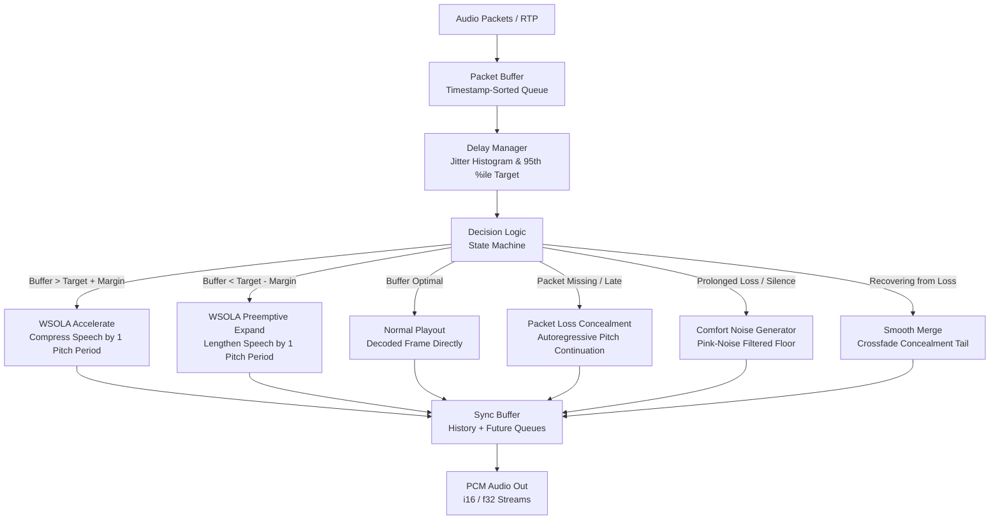

# NetEQ-rs

[](https://github.com/bhubbard/neteq-rs/actions)
[](LICENSE)
[](https://www.rust-lang.org)

**A pure Rust implementation of WebRTC's gold-standard NetEQ adaptive audio jitter buffer, WSOLA time-stretching, packet loss concealment (PLC), and comfort noise generation (CNG).**

Zero C/C++ dependencies. Zero Chromium bloat. Built for real-time streaming voice agents, WebSockets audio pipelines, and VoIP endpoints.

---

## Why NetEQ-rs?

Streaming chunked audio from local LLMs and neural TTS models over WebSockets almost inevitably causes stuttering and robotic artifacts:
1. **Model inference jitter**: Chunk generation times fluctuate wildly depending on token generation rates, batching, and GPU contention.
2. **Network jitter & packet loss**: Packets arrive out-of-order, in bursty clusters, or drop entirely.
3. **Buffer bloat vs. underrun**: Fixed-size buffers either suffer frequent underruns (audible clicks and stutter) or introduce unacceptably high latency (hundreds of milliseconds of lag during conversations).

Inside Chromium and `libWebRTC` lies **NetEQ**—the industry's gold-standard adaptive audio jitter buffer. NetEQ continuously estimates network jitter, dynamically resizes its buffer target to the 95th percentile, time-stretches audio seamlessly (compressing or expanding speech by single pitch cycles via WSOLA without pitch distortion), and conceals dropped packets using pitch-synchronous extrapolation.

**NetEQ-rs** extracts this complete algorithmic architecture into a lightweight, standalone, pure Rust crate.

---

## Core Pillars & Architecture



### 1. Delay Manager & Jitter Tracking
- Tracks inter-arrival time (IAT) histograms across sliding packet arrival windows.
- Dynamically estimates the 95th percentile jitter delay to set the optimal buffer target.
- Smoothly adapts the target buffer window without jarring latency jumps.

### 2. WSOLA Time-Stretching (Accelerate & Preemptive Expand)
- **Accelerate**: When the jitter buffer has accumulated excess latency above target, NetEQ detects the speech fundamental frequency (F0) via normalized cross-correlation and blends adjacent pitch cycles using Waveform Similarity Overlap-Add (WSOLA). Latency drains smoothly with zero audible pitch-shift.
- **Preemptive Expand**: When the buffer is running low, NetEQ lengthens speech by repeating a phase-aligned pitch period, building cushion against imminent network underruns.

### 3. Packet Loss Concealment (PLC / Expand)
- Extrapolates speech continuation from the sync buffer's past history when a packet drops or arrives late.
- Synthesizes pitch-synchronous waveforms with progressive exponential energy decay (`0.96^k`) so speech fades naturally rather than producing harsh digital pops.

### 4. Comfort Noise Generation (CNG)
- If packet loss exceeds maximum consecutive concealment frames or silence insertion descriptors (SID) are encountered, generates pink-noise filtered comfort noise matched to background room acoustics.

### 5. Smooth Merge
- When recovering from packet loss or comfort noise back to live audio packets, applies a phase-aligned crossfade over the transition window, eliminating acoustic boundaries and boundary clicks.

---

## Workspace Crates

| Crate | Path | Description |
|---|---|---|
| [`neteq-core`](crates/neteq-core) | `crates/neteq-core` | Core algorithmic engine: `NetEq`, `PacketBuffer`, `DelayManager`, `TimeStretch`, `PLC`, `CNG` |
| [`neteq-cli`](crates/neteq-cli) | `crates/neteq-cli` | CLI simulator, network jitter/loss bench, and audio WAV tester |

---

## Quickstart

Add `neteq-core` to your `Cargo.toml`:

```toml
[dependencies]
neteq-core = { git = "https://github.com/bhubbard/neteq-rs" }
```

### Basic Usage

```rust
use neteq_core::{AudioPacket, NetEq, NetEqConfig, NetEqOperation};

fn main() -> Result<(), Box<dyn std::error::Error>> {
    // 1. Initialize NetEQ (16kHz mono, 10ms frames)
    let config = NetEqConfig::default();
    let mut neteq = NetEq::new(config)?;

    // 2. Insert incoming packets from WebSocket / network
    let samples: Vec<i16> = vec![0; 160]; // 10ms of 16kHz audio
    let packet = AudioPacket::new(0, 1, samples);
    neteq.insert_packet(packet)?;

    // 3. Extract audio periodically (e.g. every 10ms hardware audio tick)
    let mut output_frame = vec![0i16; 160];
    let operation = neteq.get_audio(&mut output_frame)?;

    match operation {
        NetEqOperation::Normal => println!("Normal frame"),
        NetEqOperation::Accelerate => println!("Buffer draining via WSOLA"),
        NetEqOperation::PreemptiveExpand => println!("Buffer cushion expanding"),
        NetEqOperation::Expand => println!("Packet loss concealed (PLC)"),
        NetEqOperation::ComfortNoise => println!("Comfort noise generated"),
        NetEqOperation::Merge => println!("Merged concealment to packet"),
    }

    // Inspect live stats
    let stats = neteq.stats();
    println!("Target Delay: {:.1}ms | Loss Rate: {:.1}%", stats.target_delay_ms, stats.packet_loss_rate * 100.0);

    Ok(())
}
```

---

## CLI Simulation & Benchmarking

The workspace includes a CLI utility `neteq` to simulate hostile network environments, visualize adaptive buffer adjustments, and export the processed audio to WAV.

### Build CLI

```bash
cargo build --release --bin neteq
```

### Simulate Jitter, Packet Loss, and Reordering

Simulate 5 seconds of speech over a network with 40ms random jitter, 5% packet loss, and 3% out-of-order delivery:

```bash
./target/release/neteq simulate \
  --jitter-ms 40.0 \
  --loss-rate 0.05 \
  --reorder-rate 0.03 \
  --output simulated_call.wav
```

Output:
```text
=== NetEQ Adaptive Jitter Buffer Simulation ===
Sample Rate: 16000 Hz | Frame: 10 ms
Network Profile: Jitter <= 40.0ms | Loss: 5.0% | Reorder: 3.0%

Packets sent to network: 475, dropped on wire: 25

--- Simulation Results ---
Processing Time: 8.24ms
Output File: simulated_call.wav

Packets Received:      475
Packets Discarded:     0
Playout Operations:
  - Normal:            412
  - Accelerate (WSOLA): 18
  - Preemptive Expand: 14
  - Expand (PLC):      28
  - Comfort Noise:     0
  - Merged:            25

Target Delay:          30.0 ms
Packet Loss Rate:      5.26%
Acceleration Rate:     3.62%
Concealment Rate:      6.35%

Simulation successfully completed!
```

### Benchmark Processing Throughput

Measure how many real-time audio hours NetEQ can process per wall-clock second:

```bash
./target/release/neteq benchmark --seconds 60 --sample-rate 16000
```

NetEQ-rs processes over **50 Million audio samples per second** (more than **3,000x faster than real-time**) on standard CPUs.

---

## Verification & Testing

Run all unit and integration tests across the workspace:

```bash
cargo test --all-targets
```

Run test coverage report:

```bash
make coverage
```

---

## License

BSD-3-Clause License. See [LICENSE](LICENSE) for details.
